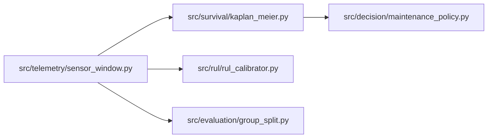

<div align="center">

# CBMX — Condition-Based Maintenance & Survival Intelligence
### Analyse de Survie Censurée à Droite, Prédiction RUL & Maintenance à Coût Minimal


</div>

---

## Problématique Scientifique

Comment modéliser conjointement le risque de défaillance censuré à droite et la durée de vie résiduelle (*RUL*) d'équipements industriels afin de minimiser le coût total de maintenance sous perte asymétrique ?

## Architecture du Domaine (`src/`)



## Démarrage Rapide

```bash
pytest
python main.py
```

## Dictionnaire des Variables

| Variable | Unité | Description |
|---|---|---|
| `unit_id` | `int` | Identifiant unique d'équipement |
| `cycle` | `int` | Cycle opérationnel monotone |
| `temp_sensor` | `K` | Température capteur turbine |
| `vibration_sensor` | `mm/s` | Amplitude vibratoire |
| `failed` | `bool` | Indicateur d'événement (False = censuré) |
