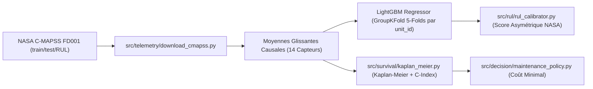

<div align="center">

# CBMX — Condition-Based Maintenance & Survival Intelligence
### Analyse de Survie Censurée à Droite, Prédiction RUL LightGBM & Maintenance à Coût Minimal (NASA C-MAPSS FD001)

<br/>


<br/>

**"From Data to Systems"**  
Pipeline complet de maintenance prédictive sur le benchmark officiel **NASA C-MAPSS FD001** (100 moteurs d'entraînement, 20 631 cycles, 100 moteurs de test censurés à droite), unifiant estimation de survie de Kaplan-Meier, régression RUL par `LightGBM` sous `GroupKFold` et optimisation décisionnelle sous coût asymétrique.

</div>

<br/>

<table align="center">
<tr>
<td align="center"><h2>100 / 100</h2><sub>moteurs train / test (FD001)</sub></td>
<td align="center"><h2>20,631</h2><sub>cycles capteurs (train)</sub></td>
<td align="center"><h2>18.31</h2><sub>RMSE RUL (cycles test)</sub></td>
<td align="center"><h2>13.37</h2><sub>MAE RUL (cycles test)</sub></td>
<td align="center"><h2>10.05</h2><sub>Score Asymétrique NASA</sub></td>
<td align="center"><h2>810 €</h2><sub>coût optimal / unité (seuil 0.90)</sub></td>
</tr>
</table>

---

## Table des Matières

1. [Problématique Industrielle & Asymétrie du Risque](#problématique-industrielle--asymétrie-du-risque)
2. [Téléchargement, Préparation & Schéma NASA C-MAPSS FD001](#téléchargement-préparation--schéma-nasa-c-mapss-fd001)
3. [Architecture & Pipeline de Traitement](#architecture--pipeline-de-traitement)
4. [Modélisation RUL, Survie & Politique de Maintenance](#modélisation-rul-survie--politique-de-maintenance)
5. [Résultats Empiriques & Preuves Visuelles](#résultats-empiriques--preuves-visuelles)
6. [Dashboard Interactif & Démarrage Rapide](#dashboard-interactif--démarrage-rapide)

---

## Problématique Industrielle & Asymétrie du Risque

En maintenance aéronautique, deux erreurs ont des coûts radicalement asymétriques :
- **Remplacement prématuré** : perte résiduelle modérée (`1 500 EUR/unité`).
- **Panne non planifiée en service** : coût critique (`12 000 EUR/unité`).

De même, le score officiel NASA pénalise exponentiellement plus les prédictions tardives ($\hat{y} > y$, dénominateur `10`) que les alertes précoces ($\hat{y} < y$, dénominateur `13`).

---

## Téléchargement, Préparation & Schéma NASA C-MAPSS FD001

Le module [`src/telemetry/download_cmapss.py`](./src/telemetry/download_cmapss.py) télécharge les trois fichiers officiels dans [`data/`](./data/) :
1. **`train_FD001.txt`** (`100` moteurs observés jusqu'à la panne, `20 631` cycles).
2. **`test_FD001.txt`** (`100` moteurs tronqués avant panne — censure à droite).
3. **`RUL_FD001.txt`** (`100` durées de vie résiduelles exactes pour l'évaluation finale).

**Préparation & Feature Engineering sans fuite :**
- Sélection des `14` capteurs actifs (`s2, s3, s4, s7, s8, s9, s11, s12, s13, s14, s15, s17, s20, s21`) après élimination des capteurs constants.
- Calcul de moyennes glissantes causales sur 5 cycles (`groupby("unit_id")`) garantissant zéro fuite inter-moteurs.
- Cible RUL bornée par morceaux à `125` cycles (*piece-wise linear degradation*), protocole standard C-MAPSS.

---

## Architecture & Pipeline de Traitement



---

## Modélisation RUL, Survie & Politique de Maintenance

1. **Validation `GroupKFold` (5 folds par `unit_id`)** : aucun cycle d'un même moteur n'apparaît simultanément en apprentissage et en validation.
2. **Évaluation officielle `test_FD001` (100 moteurs)** : `RMSE = 18.3093` cycles, `MAE = 13.3683` cycles, `Score Asymétrique NASA = 10.0474`.
3. **Survie Censurée à Droite** : courbe de Kaplan-Meier sur les 200 moteurs (`66` paliers d'événements, `C-index = 0.6057`) et sélection du seuil optimal d'intervention à `0.90` réduisant le coût attendu à **`810.00 EUR/unité`**.

---

## Résultats Empiriques & Preuves Visuelles

| Figure | Description |
|---|---|
|  | **Courbes de Survie Kaplan-Meier (FD001).** Stratification par tercile de dégradation capteurs sous censure à droite. |
|  | **Prédictions RUL sur `test_FD001` (100 Moteurs).** Parité prédit vs réel (`RMSE = 18.31`) et distribution des erreurs asymétriques. |
|  | **Courbe de Coût Décisionnel.** Minimisation du coût moyen de flotte à `810 EUR/unité` au seuil optimal `0.90`. |

---

## Dashboard Interactif & Démarrage Rapide

- Dashboard HTML5 autonome : [`artifacts/dashboard.html`](./artifacts/dashboard.html)
- Résultats JSON : [`artifacts/results.json`](./artifacts/results.json)

```powershell
.\run.ps1
pytest -v
```
