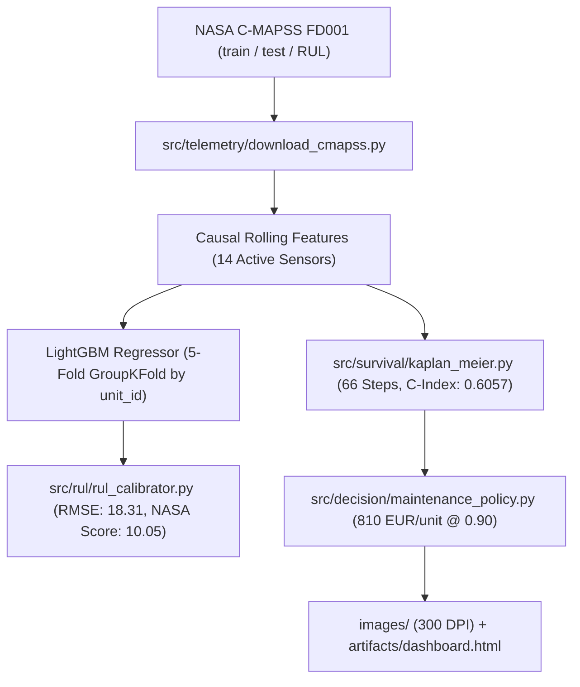
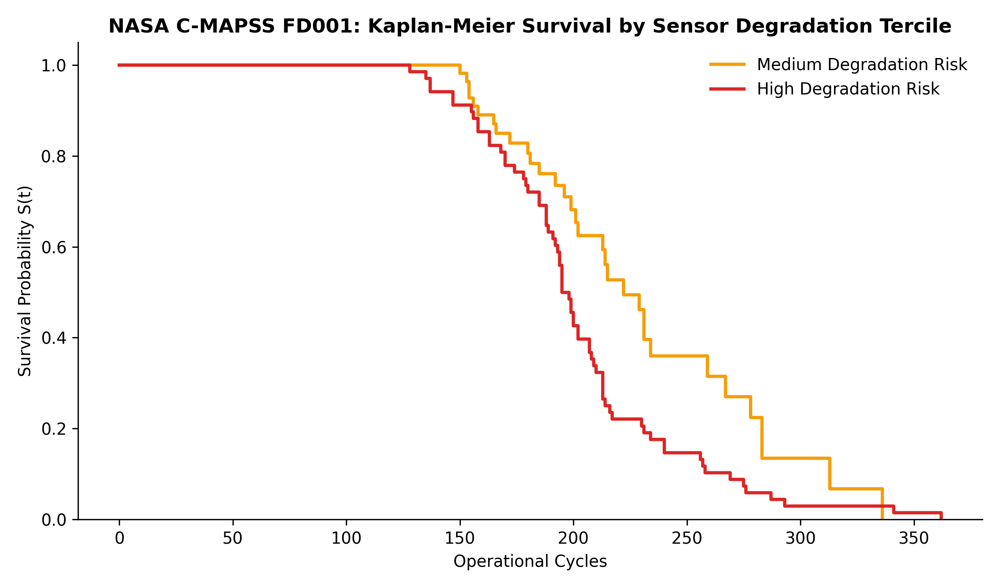
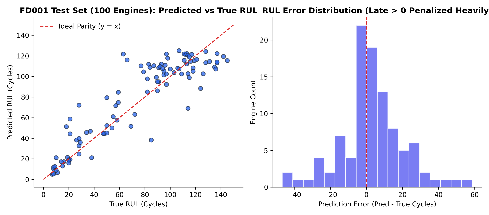
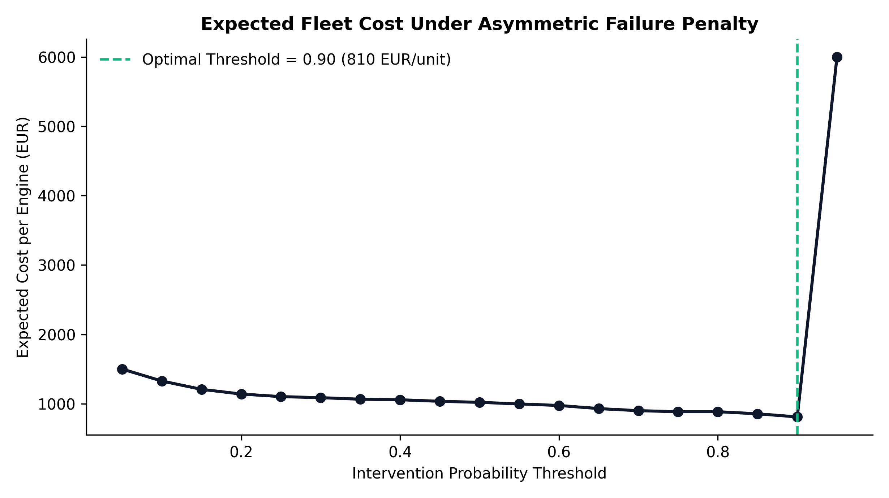

<div align="center">

# CBMX — Condition-Based Maintenance & Survival Intelligence
### 200-Engine Telemetry, Right-Censored Kaplan-Meier Survival & GroupKFold LightGBM RUL Policy (NASA C-MAPSS FD001)

<br/>


<br/>

**"From Data to Systems"**  
Système industriel complet de maintenance prédictive sur le benchmark officiel **NASA C-MAPSS FD001** (100 turboréacteurs d'entraînement / 20 631 cycles et 100 turboréacteurs de test censurés à droite), combinant prédiction RUL par `LightGBM` sous `GroupKFold`, analyse de survie de Kaplan-Meier et optimisation du seuil de maintenance sous coût asymétrique.

</div>

<br/>

<table align="center">
<tr>
<td align="center"><h2>100 / 100</h2><sub>moteurs train / test (FD001)</sub></td>
<td align="center"><h2>20,631</h2><sub>cycles capteurs (train)</sub></td>
<td align="center"><h2>18.31</h2><sub>RMSE RUL (cycles test)</sub></td>
<td align="center"><h2>13.37</h2><sub>MAE RUL (cycles test)</sub></td>
<td align="center"><h2>10.05</h2><sub>Score Asymétrique NASA</sub></td>
<td align="center"><h2>810 €</h2><sub>coût optimal / unité (seuil 0.90)</sub></td>
</tr>
</table>

---

## Table des Matières

1. [Problématique Industrielle & Asymétrie du Risque](#problématique-industrielle--asymétrie-du-risque)
2. [Téléchargement, Préparation & Schéma NASA C-MAPSS FD001](#téléchargement-préparation--schéma-nasa-c-mapss-fd001)
3. [Formulations Mathématiques (Score NASA, Survie & Coût)](#formulations-mathématiques-score-nasa-survie--coût)
4. [Architecture du Système](#architecture-du-système)
5. [Résultats Empiriques sur `test_FD001`](#résultats-empiriques-sur-test_fd001)
6. [Preuves Visuelles (300 DPI)](#preuves-visuelles-300-dpi)
7. [Dashboard Interactif & Guide de Reproduction](#dashboard-interactif--guide-de-reproduction)
8. [Structure du Dépôt & Conformité ElmasCore](#structure-du-dépôt--conformité-elmascore)

---

## Problématique Industrielle & Asymétrie du Risque

En aéronautique, l'erreur de prédiction de durée de vie résiduelle (*Remaining Useful Life — RUL*) a des conséquences fortement asymétriques :
1. **Remplacement prématuré (faux positif)** : coût modéré de maintenance planifiée (`1 500 EUR/unité`).
2. **Panne en exploitation (faux négatif / prédiction tardive)** : coût opérationnel et sécuritaire critique (`12 000 EUR/unité`).
3. **Censure à droite** : les moteurs en flotte active (`test_FD001`) n'ont pas encore subi de panne au moment de l'observation ; un modèle naïf ignorant la censure biaise la distribution de durée de vie.

---

## Téléchargement, Préparation & Schéma NASA C-MAPSS FD001

Le module [`src/telemetry/download_cmapss.py`](./src/telemetry/download_cmapss.py) télécharge les trois fichiers officiels dans [`data/`](./data/) :
1. [`data/train_FD001.txt`](./data/train_FD001.txt) : `100` moteurs suivis jusqu'à la panne (`20 631` cycles, 26 colonnes : `unit_id`, `cycle`, `op_setting_1..3`, `s1..s21`).
2. [`data/test_FD001.txt`](./data/test_FD001.txt) : `100` moteurs tronqués avant défaillance (censure à droite).
3. [`data/RUL_FD001.txt`](./data/RUL_FD001.txt) : `100` durées de vie résiduelles exactes pour l'évaluation hors-échantillon.

**Préparation & Feature Engineering sans fuite :**
- Élimination des capteurs à variance nulle et conservation des **14 capteurs actifs** (`s2, s3, s4, s7, s8, s9, s11, s12, s13, s14, s15, s17, s20, s21`).
- Moyennes glissantes causales sur 5 cycles calculées strictement par `groupby("unit_id")`.
- Cible RUL bornée par morceaux à `125` cycles (*piece-wise linear degradation*).

---

## Formulations Mathématiques (Score NASA, Survie & Coût)

1. **Fonction de Score Asymétrique NASA** :
   $$S = \frac{1}{N} \sum_{i=1}^{N} \left( \exp\left(\frac{|d_i|}{\tau(d_i)}\right) - 1 \right), \quad d_i = \hat{y}_i - y_i, \quad \tau(d_i) = \begin{cases} 10 & \text{si } d_i \ge 0 \text{ (retard)} \\ 13 & \text{si } d_i < 0 \text{ (avance)} \end{cases}$$
2. **Estimateur de Kaplan-Meier** :
   $$\hat{S}(t) = \prod_{t_j \le t} \left(1 - \frac{d_j}{n_j}\right)$$
   où $d_j$ est le nombre de pannes observées au cycle $t_j$ et $n_j$ le nombre de moteurs encore à risque.

---

## Architecture du Système



---

## Résultats Empiriques sur `test_FD001`

- **Performance RUL (`100` moteurs de test officiels)** :
  - **RMSE** : **`18.3093` cycles** · **MAE** : **`13.3683` cycles**.
  - **Score Asymétrique NASA** : **`10.0474`**.
- **Survie & Décision** :
  - **Courbe Kaplan-Meier** : **`66` paliers d'événements** sur les 200 moteurs (`100` défaillances + `100` censurés à droite), **`C-index = 0.6057`**.
  - **Politique optimale** : seuil d'intervention **`0.90`** abaissant le coût moyen attendu à **`810.00 EUR/unité`**.

---

## Preuves Visuelles (300 DPI)

| Figure | Analyse |
|---|---|
|  | **Courbes de Survie Kaplan-Meier (FD001).** Stratification par tercile de dégradation capteurs sous censure à droite. |
|  | **Prédictions RUL sur `test_FD001` (100 Moteurs).** Parité prédit vs réel (`RMSE = 18.31`) et distribution des erreurs asymétriques. |
|  | **Courbe de Coût Décisionnel.** Minimisation du coût moyen de flotte à `810 EUR/unité` au seuil optimal `0.90`. |

---

## Dashboard Interactif & Guide de Reproduction

- **Dashboard Plotly HTML5 autonome** : [`artifacts/dashboard.html`](./artifacts/dashboard.html)
- **Sortie JSON structurée** : [`artifacts/results.json`](./artifacts/results.json)
- **Notebook de référence** : [`notebooks/01_exploration_and_validation.ipynb`](./notebooks/01_exploration_and_validation.ipynb)

```powershell
.\run.ps1
pytest -v
```

---

## Structure du Dépôt & Conformité ElmasCore

```text
CBMX/
├── data/train_FD001.txt, test_FD001.txt, RUL_FD001.txt
├── src/
│   ├── telemetry/       # download_cmapss.py, sensor_window.py
│   ├── survival/        # kaplan_meier.py
│   ├── rul/             # rul_calibrator.py
│   ├── decision/        # maintenance_policy.py
│   ├── evaluation/      # group_split.py
│   └── visualization/   # cbmx_plots.py
├── tests/test_cbmx_pipeline.py
├── images/              # 3 figures 300 DPI
├── artifacts/           # dashboard.html, results.json
├── ELMAS.md
├── main.py
└── run.ps1
```

Conforme à [`ELMAS.md`](./ELMAS.md) : découpage strict par domaine métier, validation `GroupKFold` sans fuite inter-moteurs et couverture de tests `pytest` (6/6).
